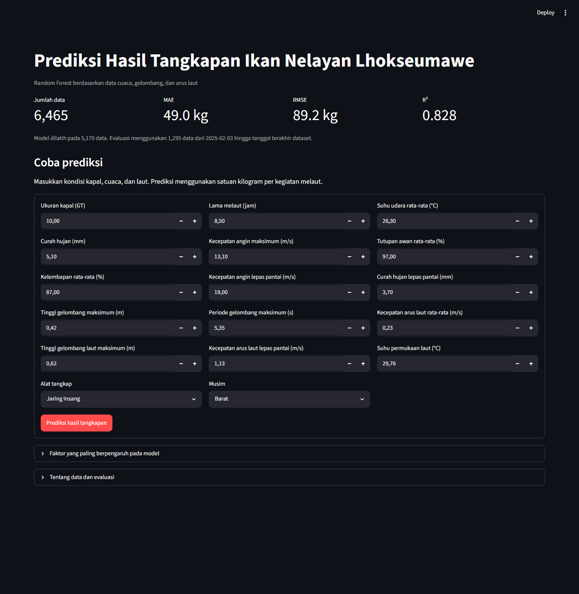

# Prediksi Hasil Tangkapan Ikan Nelayan Lhokseumawe

Aplikasi prediksi hasil tangkapan ikan (`hasil_kg`) menggunakan Random Forest
Regressor berdasarkan data cuaca, gelombang, arus laut, dan karakteristik
kegiatan melaut.

## Tampilan aplikasi



## Isi project

- `app.py`: dashboard Streamlit untuk melihat evaluasi, faktor penting, dan
  mencoba prediksi.
- `model.py`: pemilihan fitur, preprocessing, pembagian data berbasis waktu,
  pelatihan, dan evaluasi model.
- `dataset_final.csv`: dataset penelitian yang digunakan aplikasi.
- `tests/`: pengujian pemisahan data dan alur pelatihan.

Model menggunakan 17 fitur, yaitu ukuran kapal, lama melaut, alat tangkap,
musim, sejumlah variabel cuaca, tinggi/periode gelombang, arus laut, dan suhu
permukaan laut. Kolom hasil turunan seperti `hasil_log` dan `hasil_per_jam`
tidak digunakan sebagai fitur untuk menghindari kebocoran target.

## Menjalankan aplikasi

Disarankan menggunakan Python 3.10 atau lebih baru.

```powershell
python -m venv .venv
.\.venv\Scripts\Activate.ps1
python -m pip install -r requirements.txt
streamlit run app.py
```

Jika PowerShell membatasi aktivasi virtual environment, jalankan perintah
Python dan Streamlit menggunakan path `.venv\Scripts\python.exe` dan
`.venv\Scripts\streamlit.exe`.

## Menjalankan pengujian

```powershell
python -m unittest discover -s tests -v
```

## Hasil prediksi dan evaluasi

### Apa yang diprediksi

Target model adalah `hasil_kg`: perkiraan berat tangkapan dalam kilogram untuk
satu baris kegiatan melaut (kapal pada tanggal tertentu). Ini bukan prediksi
jumlah tangkapan seluruh kapal atau total tangkapan untuk satu musim. Di
dashboard, isi formulir dengan kondisi kapal, cuaca, gelombang, arus, dan musim,
lalu pilih **Prediksi hasil tangkapan** untuk melihat perkiraan dalam kilogram.
Formulir dimulai dengan nilai median fitur numerik pada dataset dan kategori
yang tersedia; ubah nilainya agar sesuai dengan skenario yang ingin diuji.

Model menggunakan Random Forest Regressor dengan 300 pohon, `min_samples_leaf`
2, dan `random_state` 42. Fitur numerik yang kosong diimputasi dengan median,
fitur kategori yang kosong dengan kategori terbanyak, dan kategori diubah
menjadi representasi one-hot. Fitur masukan terdiri dari:

- Kapal dan kegiatan: ukuran kapal (`gt`), lama melaut, dan alat tangkap.
- Musim.
- Cuaca: suhu rata-rata, curah hujan, kecepatan angin maksimum, tutupan awan,
  kelembapan, serta kecepatan angin maksimum dan curah hujan lepas pantai.
- Laut: tinggi dan periode gelombang maksimum, kecepatan arus laut rata-rata,
  tinggi gelombang maksimum lepas pantai, kecepatan arus laut rata-rata lepas
  pantai, dan suhu permukaan laut.

### Metode pengujian

Evaluasi menggunakan 6.465 baris dari 1.293 tanggal (2022-01-04–2025-11-17).
Data diurutkan secara kronologis: 80% tanggal paling awal untuk pelatihan
(5.170 baris, hingga 2025-02-02), dan 20% tanggal terakhir untuk pengujian
(1.295 baris, 2025-02-03–2025-11-17). Semua baris pada tanggal yang sama
ditempatkan pada partisi yang sama. Dengan demikian, pengujian mengukur
performa pada tanggal yang lebih baru daripada data latih, bukan pembagian
acak antarbaris.

### Hasil pada data uji

| Metrik | Hasil | Makna |
| --- | ---: | --- |
| MAE (Mean Absolute Error) | **49,02 kg** | Rata-rata selisih absolut antara prediksi dan hasil aktual. |
| Median Absolute Error | **21,15 kg** | Nilai tengah selisih absolut; separuh prediksi memiliki selisih tidak lebih dari nilai ini. |
| RMSE (Root Mean Squared Error) | **89,18 kg** | Akar rata-rata kuadrat error; lebih sensitif terhadap beberapa error yang besar daripada MAE. |
| R² (koefisien determinasi) | **0,8284** | Model menerangkan sekitar 82,84% variasi target pada data uji relatif terhadap prediksi rata-rata data uji. |
| MAPE (Mean Absolute Percentage Error) | **27,39%** | Rata-rata error absolut sebagai persentase hasil aktual. Nilai ini dapat lebih dipengaruhi tangkapan kecil. |

Angka tersebut adalah hasil evaluasi satu pembagian waktu pada dataset ini.
Nilai R² **bukan** “akurasi 82,84%” seperti pada klasifikasi; regresi tidak
memiliki satu angka akurasi universal. Karena itu, MAE dan RMSE dalam kilogram
lebih langsung menunjukkan skala selisih prediksi.

Sebagai pembanding sederhana, jika setiap baris data uji selalu diprediksi
menggunakan rata-rata target data latih (200,85 kg), hasilnya MAE **160,83 kg**,
RMSE **215,42 kg**, dan R² **-0,0014**. Random Forest memperoleh error lebih
rendah pada pembagian data uji yang sama. Pembanding ini bukan jaminan bahwa
model akan lebih baik pada data baru dari periode atau kondisi yang berbeda.

### Cara membaca hasil dan batasan

- Hasil pada formulir adalah perkiraan, bukan jaminan jumlah tangkapan aktual.
- Nilai metrik menggambarkan performa pada rentang data uji 2025-02-03 sampai
  2025-11-17; performa dapat berubah ketika dataset, pembagian waktu, atau
  konfigurasi model berubah.
- RMSE yang lebih besar daripada MAE menunjukkan bahwa error besar memberi
  pengaruh berarti pada hasil. Periksa kedua metrik, bukan R² saja.
- MAPE mengukur error relatif sehingga hasil tangkapan kecil dapat memberi
  persentase error yang besar. Gunakan MAE/RMSE juga untuk menilai error dalam
  satuan kilogram.
- Prediksi sebaiknya digunakan untuk eksplorasi dan pendukung analisis, bukan
  keputusan operasional keselamatan melaut. Kondisi di luar rentang data
  historis dapat menghasilkan prediksi yang kurang andal.

## Git

Repository lokal telah disiapkan. Perintah dasar:

```powershell
git status
git add .
git commit -m "Tambahkan project prediksi hasil tangkapan ikan"
```
